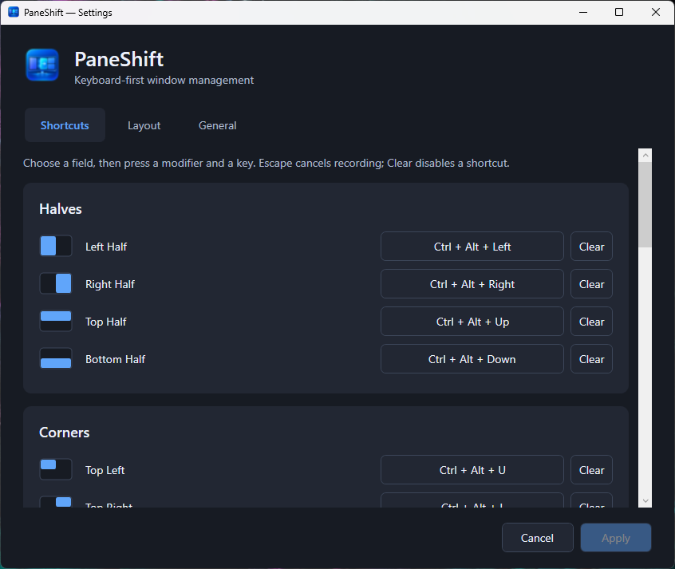
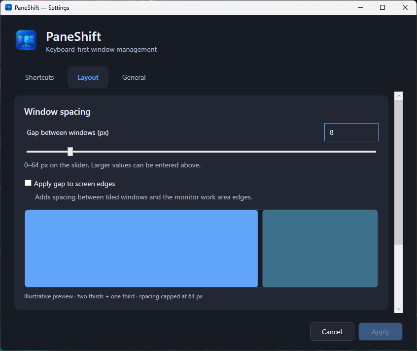
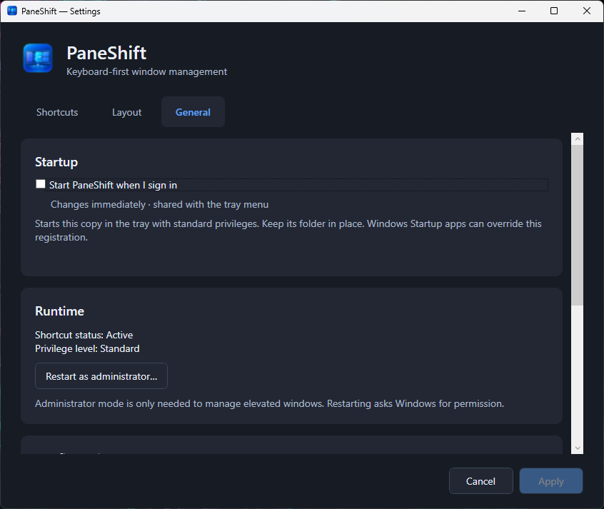

<p align="center">
  
</p>

# PaneShift

**Keyboard-first window management for Windows.**

Arrange windows with configurable shortcuts, precise layouts and adjustable spacing. PaneShift lives in your notification area and keeps its settings in a native Windows interface.

[Explore the website](https://paneshift.ksmvc.ch/) · [Download PaneShift](https://github.com/Ken5998/PaneShift/releases/latest)

[](https://github.com/Ken5998/PaneShift/releases)
[](https://dotnet.microsoft.com/)
[](LICENSE)
[](https://github.com/Ken5998/PaneShift/actions/workflows/ci.yml)
[](https://github.com/Ken5998/PaneShift/releases/latest)

<table>
  <tr>
    <td width="50%"></td>
    <td width="50%"></td>
  </tr>
  <tr><td align="center">Your shortcuts, your layouts</td><td align="center">Precise spacing in physical pixels</td></tr>
</table>

## Features

- Halves, corners, thirds, two-thirds and all six sixths, plus Maximize, Center and Restore.
- Repeated half shortcuts cycle **1/2 → 2/3 → 1/3** along the same edge.
- Repeated third, two-thirds and sixth shortcuts cycle horizontally while keeping the same size and row.
- Configurable hotkeys with a keyboard recorder, explicit clearing and duplicate detection.
- Adjustable gaps between windows and optional spacing at monitor work-area edges.
- Multi-monitor work-area geometry, negative monitor coordinates and Per-Monitor V2 DPI awareness.
- Native WPF Settings with light/dark appearance, draft editing and Apply/Cancel.
- Safe configuration reload and hotkey changes: failed activation preserves working settings.
- Tray pause/resume and explicit administrator restart for elevated windows.
- Optional start at sign-in, shared between the tray menu and General settings.
- Optional Mac-style application shortcuts: Win+C/V, tab management and graceful window closing.
- Optional release checks every 24 hours, manual Check now, and verified updates started by the user.

An independent MIT-licensed implementation inspired by Rectangle's positioning workflow on macOS. No Rectangle code, branding or assets are reused.

## Installation

**Requires Windows 11 x64.** Release packages include the .NET runtime; users do not need to install .NET separately.

Download the installer or portable ZIP from the [latest published GitHub release](https://github.com/Ken5998/PaneShift/releases/latest). **PaneShift v0.3.0** brings per-user MSI installation, optional Mac-style shortcuts and opt-in release checks. See the [0.3.0 release notes](docs/RELEASE_NOTES_0.3.0.md) and [validation record](docs/VALIDATION_0.3.0.md).

Or install/update from PowerShell without administrator rights:

```powershell
irm https://paneshift.ksmvc.ch/win | iex
```

The script downloads the latest published installer from GitHub, verifies it against the release's SHA-256 checksum, waits for you to exit a running PaneShift copy, performs a silent per-user install/update, and launches PaneShift afterward. Use `& ([scriptblock]::Create((irm https://paneshift.ksmvc.ch/win))) -NoLaunch` to leave it closed, or add `-Force` to reinstall the current version. As with every `irm | iex` command, inspect [the script](https://paneshift.ksmvc.ch/win.ps1) first if desired.

| Package | How to use it |
| --- | --- |
| `PaneShift-0.3.0-Setup-x64.msi` | Per-user Windows Installer package in `%LOCALAPPDATA%\Programs\PaneShift-MSI`. Migrates a previous default Inno installation after the new payload has committed. |
| `PaneShift-<version>-win-x64.zip` | Extract **all** files into a folder, then run `PaneShift.App.exe`. No installation needed. |
| `SHA256SUMS.txt` | SHA-256 hashes of the final installer and ZIP. Compare using `Get-FileHash -Algorithm SHA256`. |

Exit a running copy before installing an update or switching between installed and portable builds. A second copy cannot run alongside the first. The portable build uses the same per-user configuration location as the installed build.

Normal installation does not request administrator privileges. Uninstall removes installed application files and shortcuts, while preserving your configuration. Startup at sign-in is off until you enable it in the app; uninstall removes its entry only when it points to that installed copy. MSI upgrades preserve this preference. The MSI replaces the historical EXE installer; close PaneShift through the tray's **Exit** command before migrating. Custom-location Inno installations require manual removal before migration; see [MSI migration](docs/UPDATES.md#msi-migration).

## Updates

In **Settings → General → Updates**, enable **Check for updates automatically** and Apply to opt in. It checks GitHub on launch when due and every 24 hours while running. Existing configurations default to off. **Check now** and the tray's **Check for updates...** work independently of the flag. Drafts, prereleases and older versions are not offered.

An available release shows its notes and a **Download and install** button for installed copies. After confirmation, PaneShift downloads the MSI, verifies its size and GitHub SHA-256 digest, exits normally, opens Windows Installer and restarts the installed version after success. Cancellation/failure restarts the previous copy where available. Elevated instances must be reopened normally to update. There are no scheduled tasks, services or unattended installations.

Portable copies offer **Download portable ZIP** instead. The verified ZIP's folder opens; extract into a new folder and exit the old copy before switching. Settings remain shared. Update checks contact GitHub only when requested or enabled, sending no settings, window information or keyboard activity. See [update behavior and privacy](docs/UPDATES.md).

## Default shortcuts

The following use **Ctrl + Alt**:

| Key | Action |
| --- | --- |
| Left / Right | Left / Right Half |
| Up / Down | Top / Bottom Half |
| U / I | Top Left / Top Right |
| J / K | Bottom Left / Bottom Right |
| D / F / G | First / Center / Last Third |
| E / R / T | First / Center / Last Two Thirds |
| Enter | Maximize |
| C | Center, preserving size |

**Ctrl + Shift + Win + Up / Down** place the Top Right / Bottom Right Sixth. There are 18 default bindings. The remaining four sixth actions and Restore can be assigned in Settings.

Release each chord before repeating it. Repeated halves cycle sizes on the same target. Thirds and two-thirds move through the horizontal positions; sixths stay in their top or bottom row. Another action, another target, pause or a failed command resets the sequence. Restore keeps the window's original placement for the current PaneShift session.

## Mac-style shortcuts

In **Settings → Keyboard**, select **Enable Mac-style shortcuts**, then **Apply**. Use the Windows key like Command on macOS for these application shortcuts. The feature is **off by default**, including upgrades from older settings files.

| Shortcut | Sent to the active application | Purpose |
| --- | --- | --- |
| Win+C | Ctrl+C | Copy |
| Win+V | Ctrl+V | Paste |
| Win+X | Ctrl+X | Cut |
| Win+A | Ctrl+A | Select all |
| Win+Z | Ctrl+Z | Undo |
| Win+Shift+Z | Ctrl+Shift+Z | Redo |
| Win+S | Ctrl+S | Save |
| Win+F | Ctrl+F | Find |
| Win+T | Ctrl+T | New tab |
| Win+Shift+T | Ctrl+Shift+T | Reopen closed tab |
| Win+W | Ctrl+W | Close tab / document |
| Win+Q | Alt+F4 | Close app / window |

Enabling replaces the listed Windows shortcuts, including **Win+V (Clipboard History), Win+A (Quick Settings), Win+S (Search), and Win+W (Widgets)**. Disable it and Apply, or pause shortcuts in the tray, to restore native behavior immediately. Win is never globally remapped to Ctrl: Win+E/R/L/D/Tab, Win+number, arrow shortcuts and combinations with extra modifiers remain unchanged (except window-management bindings you explicitly configured).

**Win+W sends Ctrl+W**, closing the current browser/Explorer tab or document where supported. **Win+Q sends Alt+F4**: normal save prompts, confirmations and cleanup remain; it does **not** forcibly terminate a process or quit every window of an application. Target apps decide what standard chords do; some editors use Ctrl+Y instead of Ctrl+Shift+Z for redo. Release the letter before repeating; holding it does not repeatedly close tabs.

An elevated target requires **Restart as administrator**. Games, raw-input software, protected windows or another keyboard utility may handle keys differently; pause shortcuts when necessary. Other utilities' hooks cannot be reliably enumerated for conflict detection. Internal conflicts with PaneShift's window shortcuts are rejected before Apply. A failed hook installation or settings save keeps the previous configuration.

## Settings

PaneShift starts in the notification area, possibly inside its overflow menu. Right-click its icon and choose **Settings...**, or double-click the icon. Reopening activates the same Settings window; closing it leaves the tray app running.

- **Shortcuts:** select a field, press modifiers and a key, or choose Clear. Escape cancels recording. Duplicates block Apply; reset-to-default changes only the draft.
- **Layout:** edit the physical-pixel gap, toggle screen-edge gaps and inspect the preview. The slider covers 0–64 px; direct input accepts larger nonnegative values. Cycle sizes is the currently supported repetition mode.
- **Keyboard:** enable Mac-style shortcuts and review their mappings. Changes follow Apply/Cancel; Restore defaults turns the feature off in the draft.
- **General:** opt in to update checks or check manually, toggle start at sign-in, check shortcut/privilege status, open the configuration file/folder, restore defaults, open the repository or request administrator restart.

**Start PaneShift when I sign in** is available in the tray menu and General. This Windows preference changes immediately in both places, independently of Apply/Cancel and Restore defaults for JSON settings. It registers the current executable for your user account, starts in the tray with standard privileges, and needs no administrator rights. Keep the executable's folder in place, especially for portable builds. If you move it, enable startup from the new copy. The checkbox refers to the current copy; enabling it replaces an older PaneShift location. Windows Startup apps can disable the registration separately. Debug builds and elevated instances cannot edit this preference; use a normal Release instance.

**Apply** validates, saves and activates the draft without restarting. If a new hotkey is unavailable or saving fails, working settings and registrations remain active. **Cancel** discards edits; closing with unsaved changes prompts you first. No changes are written on every keystroke.

<p></p>

Configuration is stored at:

```text
%LOCALAPPDATA%\PaneShift\settings.json
```

The tray's **Open Settings File** reveals the JSON in Explorer. After editing it, choose **Reload Settings**. A valid reload updates layout and hotkeys, preserves Restore history and pause state, and resets repeated-command cycles. Failed reloads retain the last working configuration. Unsaved GUI edits are preserved with an explicit reload prompt. The configuration file is not watched or polled.

Existing JSON files without a `hotkeys` section retain the original defaults. Individual entries can be set to `null` to disable a binding. See the [configuration reference](docs/SETTINGS.md) for the schema, gaps and reload details.

The Settings window uses Windows light/dark application colors when opened; reopen it after changing Windows appearance.

## Security and code signing

Code signing is not currently enabled. SignPath Foundation integration is ready to configure after acceptance. Each release's notes state its actual signing status and link to SHA-256 checksums. See the [code signing policy](docs/CODE_SIGNING.md).

Optional VirusTotal reports refer to the final downloadable files. Public VirusTotal submissions are public samples; reports are informational and false positives are possible. There is no fixed-hash VirusTotal badge or unverified clean-scan claim.

PaneShift does not transmit user information during window management or shortcut translation. The repository button opens GitHub in your browser. No telemetry, key logging, DLL injection, service, driver or process-memory manipulation is used. Typed text and keyboard activity are never recorded or transmitted.

Window-management shortcuts still use `RegisterHotKey`. Only when Mac-style shortcuts are enabled, a small global low-level keyboard hook intercepts the exact whitelist and sends balanced `SendInput` chords. Windows reserves these combinations, so `RegisterHotKey` alone cannot override them. The hook ignores injected events, uses a dedicated message thread, and is removed on disable, pause or exit. It does no background polling. See the [implementation and privacy notes](docs/ARCHITECTURE.md#mac-style-shortcut-translation).

PaneShift runs normally with standard privileges. To control elevated windows, explicitly choose **Restart as administrator...** and respond to Windows UAC. Cancelling keeps the current instance running. To return to standard privileges, Exit and launch from a standard Explorer session. Elevation does not guarantee access to every protected window.

Apps can enforce minimum sizes or reject placement. Game/fullscreen compatibility and unusual display configurations require testing; use **Pause shortcuts** when needed.

## Building from source

Requires Windows and the **.NET 10 SDK** with Windows desktop targeting support:

```powershell
dotnet restore PaneShift.sln
dotnet build PaneShift.sln -c Release
dotnet test PaneShift.sln -c Release --no-build
dotnet run --project src/PaneShift.App
```

To produce the self-contained ZIP, per-user MSI and checksums:

```powershell
./scripts/Build-Release.ps1
```

Use PowerShell 7. MSI builds use pinned WiX 6.0.2 from NuGet under ignored `artifacts/tools`; installer custom actions target the .NET Framework already included in Windows 11. Historical versions through 0.2.0 retain the Inno build path and `-IsccPath` parameter. See [release instructions](docs/RELEASING.md) for versioning, artifacts, signing and GitHub draft releases.

The earlier isolated [MSI packaging trial](docs/MSI_TRIAL.md) records the packaging evaluation that preceded the production MSI. Its v0.2.0 trial package is not the current installer.

## Architecture

| Project | Responsibility |
| --- | --- |
| `PaneShift.Core` | Pure physical-pixel geometry, settings/chord models, validation, persistence and repetition state |
| `PaneShift.Windows` | Win32/DWM positioning, transactional hotkeys, optional shortcut translation, verified release downloads and installer/restart handoff |
| `PaneShift.App` | WPF lifecycle and Settings; Windows Forms only for the tray icon/menu |
| `PaneShift.Core.Tests` / `PaneShift.Windows.Tests` | Geometry, settings, transactional rollback, draft state and Windows-support logic |

Read the [architecture notes](docs/ARCHITECTURE.md), [manual regression checklist](docs/TESTING.md), and [release acceptance checklist](docs/RELEASING.md#release-acceptance-checklist). Application tests cover geometry, settings, rollback, input translation and draft state; release-script validation is separate and does not require signing credentials or global hotkey availability.

## License

[MIT License](LICENSE) — Copyright © 2026 Kenan Kasumović. Bundled .NET runtime files retain their upstream license notices. PaneShift's original icon assets are documented in [assets/README.md](assets/README.md).
